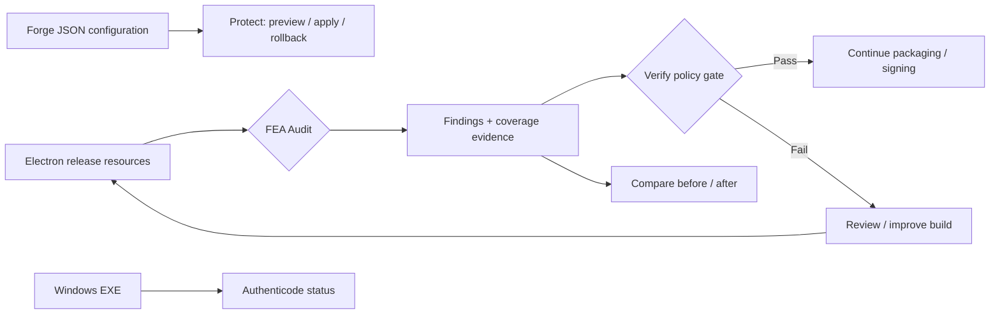

<div align="center">
  <!-- Original FEA identity, preserved byte-for-byte as assets/fea-icon.png. -->
  

  

  <br />

  [](https://github.com/MarsBaseX1/forward-engineer-anything/actions/workflows/fea-security.yml)
  [](LICENSE)
  
  
  [](https://github.com/sponsors/MarsBaseX1)

  **[简体中文](README.md) · [Quick start](#quick-start) · [Reproducible data](#reproducible-demo-data) · [Security limits](#what-fea-does-not-promise) · [Contributing](CONTRIBUTING.md)**
</div>

> **v1.0.1 release update:** In addition to the stable FEA001–FEA009 rules, Forge automation, suggestion generators, and Arena evaluation capabilities, this release adds npm package auditing, an SPDX 2.3 SBOM, digest binding, and independent release verification. See [CHANGELOG.md](CHANGELOG.md). FEA does not claim software is un-reverse-engineerable.

> **FEA (Forward Engineer Anything)** is an open-source protection engineering framework for desktop app authors. It helps teams identify unnecessarily exposed Electron assets, enforce reproducible release checks in CI, plan hardening, and compare observed findings before and after build improvements. **The goal is to raise the cost of REA-style AI-assisted reverse engineering and tampering—not to promise that code cannot be reverse engineered.**

### Why FEA?

AI-assisted analysis (e.g. [REA](https://github.com/morluto/rea)) lowers the barrier to inspecting shipped programs. Instead of claiming to hide every byte after release, ask three practical questions **before shipping**: *What is actually distributed? Which changes reduce unnecessary exposure? Did a subsequent release regress?*

FEA currently focuses on the Electron release workflow: **audit → sanitized evidence → CI policy gate → before/after comparison**. The scanner and demo run without a cloud model, paid account, or API key. See [ANTI-REA-HARDENING.md](docs/ANTI-REA-HARDENING.md).

## Reproducible demo data

<div align="center">
  
</div>

| Metric | Reproducible result | What it means |
| :--- | ---: | :--- |
| **11 → 0** | Synthetic demo findings | Deliberately planted exposures removed in the improved fixture |
| **9 classes** | FEA001–FEA009 | Source maps, private-key markers, internal config, debug assets, test assets, client auth, hardcoded secrets, unobfuscated logic, client data exposure |
| **CI verified** | Automated tests passed | Including bounded ASAR parsing, malformed inputs and explicit fallback behavior |
| **2 inputs** | Resource tree / `.asar` | Currently scoped Electron release-resource forms |

**Reproduce:** `npm test && npm run demo && npm run demo:check`. The chart is generated from `demo/generated/reports/comparison/comparison.json` by [`scripts/render-readme-chart.mjs`](scripts/render-readme-chart.mjs).

> ⚠️ **These are synthetic fixture numbers, not an independent security benchmark.** 11 → 0 synthetic findings means fewer observable release-hygiene findings on the same sample. It does not measure resistance to reverse engineering or guarantee security.

## How it works



### What works today

| Capability | Current scope | Boundary |
| :--- | :--- | :--- |
| **Audit** | Electron resource directories and bounded read-only ASAR, FEA001–FEA009 | Not an arbitrary EXE/installer parser |
| **Verify** | CI-compatible policy gate over sanitized evidence | Reports must originate in a trusted build context |
| **Compare** | Before/after JSON + Markdown | Not AI attacker-success benchmarking |
| **Protect (preview/apply/rollback)** | Review and apply ASAR + recommended integrity Fuses on supported Forge JSON; restore exact bytes from backup | No project code execution, no signed-binary modification |
| **Migrate / Obfuscate / Runtime** | Generate server-side migration, optional obfuscation, and runtime protection suggestions | Does not automatically rewrite code |
| **Signature (preview)** | Windows Authenticode status and optional expected signer thumbprint | Returns "unassessed" elsewhere; does not sign files |

## Quick start

Requires **Node.js 20+**; the scanner and demo have no install-time npm dependencies.

```bash
git clone https://github.com/MarsBaseX1/forward-engineer-anything.git
cd forward-engineer-anything
npm test
npm run demo
npm run demo:check
cat demo/generated/reports/comparison/comparison.md
```

Inspect a release-resource directory, an actual ASAR archive or an Electron Forge project:

```bash
node src/cli.mjs init --out my-fea.json
node src/cli.mjs scan ./my-electron-resources --config my-fea.json --out ./audit/resources
node src/cli.mjs verify ./audit/resources/report.json --policy my-fea.json

# Migration, obfuscation and runtime suggestions
node src/cli.mjs migrate ./audit/resources/report.json --out ./audit/migrate
node src/cli.mjs obfuscate ./audit/resources/report.json --out ./audit/obfuscate
node src/cli.mjs runtime ./audit/resources/report.json --out ./audit/runtime

node src/cli.mjs asar-scan ./my-app.asar --config my-fea.json --out ./audit/asar
```

On Windows, `node src/cli.mjs signature ./my-app.exe --out ./audit/signature --thumbprint <expected-signer-thumbprint>` performs a platform-backed status check. On unsupported hosts it reports **unassessed**, not success. See the [implementation guide](IMPLEMENTATION.md) for details.

## What FEA does not promise

- Client-distributed code can still be inspected, modified or reimplemented. **ASAR is not an encryption boundary.**
- A successful scan does not prove that an app has no secrets or vulnerabilities. Client checks never replace server-side authorization.
- Authenticity checks are not code encryption or protection against all local modifications.
- Arbitrary EXE/MSI/DMG unpacking, automated protective code patches, or real AI resistance scores are not supported.
- **v1.0.1 strengthens release integrity**, but it is not an independent security audit or certification. Package auditing and provenance do not replace Windows code signing or macOS notarization.

## Roadmap and contribution

See the [roadmap](docs/ROADMAP.md) and [threat model](docs/THREAT_MODEL.md). Contributions of rules, synthetic fixtures, tests and format adapters are welcome—see [CONTRIBUTING.md](CONTRIBUTING.md). Licensed under [Apache-2.0](LICENSE); using FEA does not require you to open-source your proprietary application. FEA is independent of the REA and Trivy teams.
