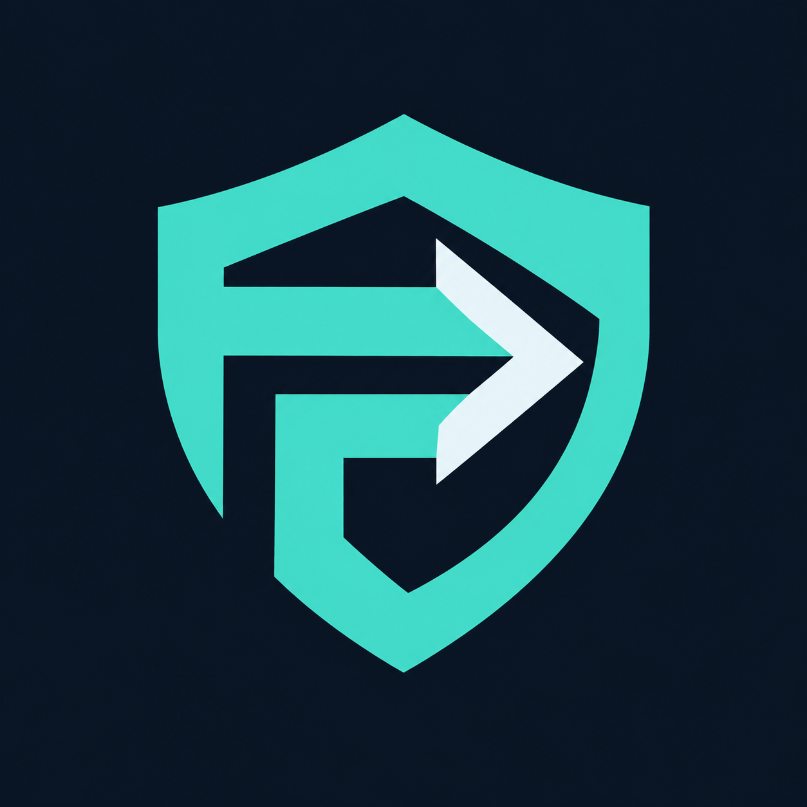
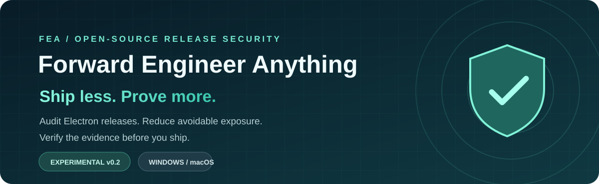
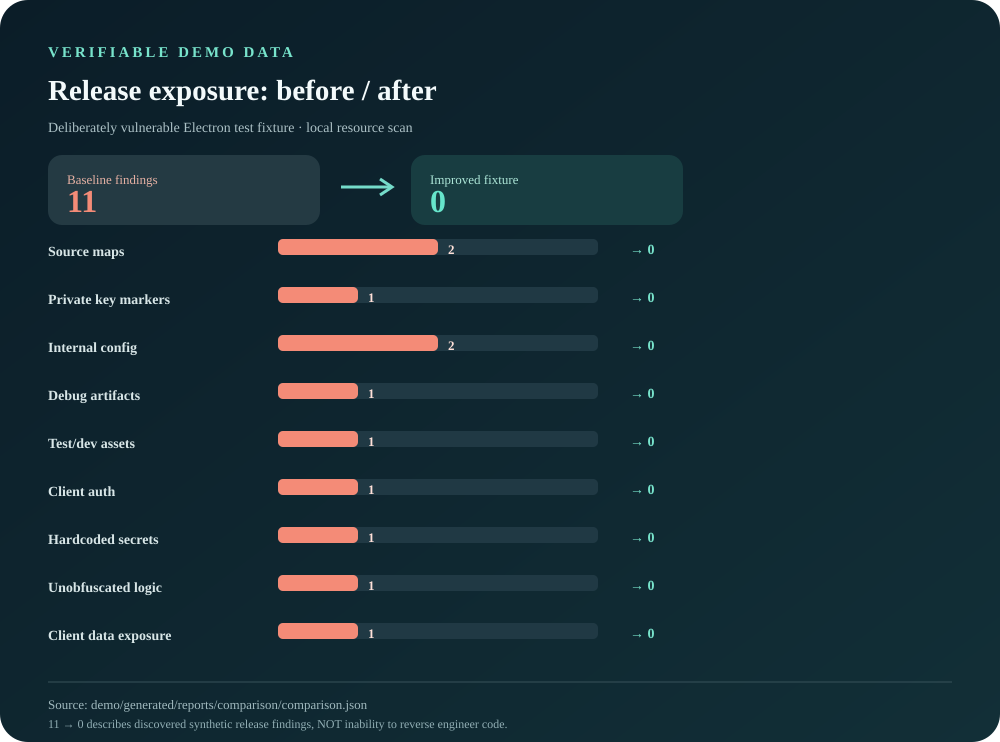
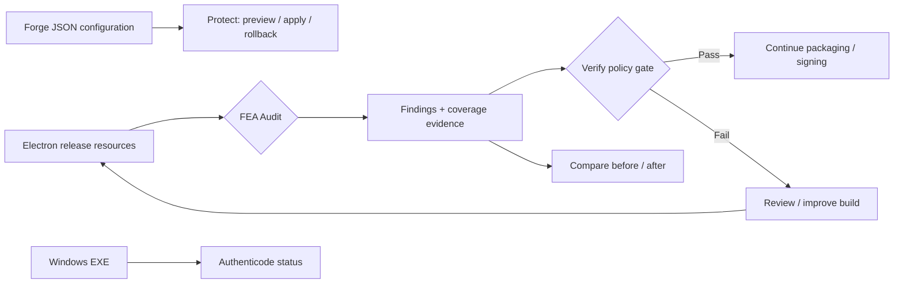

<div align="center">
  <!-- Original FEA identity, preserved byte-for-byte as assets/fea-icon.png. -->
  

  

  <br />

  [](https://github.com/MarsBaseX1/forward-engineer-anything/actions/workflows/fea-security.yml)
  [](LICENSE)
  
  

  **[简体中文](README.md) · [Quick start](#quick-start) · [Reproducible data](#reproducible-demo-data) · [Security limits](#what-fea-does-not-promise) · [Contributing](CONTRIBUTING.md)**
</div>

> **FEA (Forward Engineer Anything)** is an open-source release security tool for desktop app authors. It helps teams identify unnecessarily exposed Electron assets, enforce reproducible release checks in CI, and compare observed findings before and after build improvements. **The goal is to raise the cost of analysis and tampering—not to promise that code cannot be reverse engineered.**

### Why FEA?

AI-assisted analysis makes it easier to inspect shipped programs. Instead of claiming to hide every byte after release, ask three practical questions **before shipping**: *What is actually distributed? Which changes reduce unnecessary exposure? Did a subsequent release regress?*

FEA currently focuses on the Electron release workflow: **audit → sanitized evidence → CI policy gate → before/after comparison**. The scanner and demo run without a cloud model, paid account, or API key.

## Reproducible demo data

<div align="center">
  
</div>

| Metric | Reproducible result | What it means |
| :--- | ---: | :--- |
| **6 → 0** | Synthetic demo findings | Deliberately planted exposures removed in the improved fixture |
| **5 classes** | FEA001–FEA005 | Source maps, private-key markers, internal config, debug assets, test assets |
| **53 / 53** | Local automated tests passed | Including bounded ASAR parsing, malformed inputs and explicit fallback behavior |
| **2 inputs** | Resource tree / `.asar` | Currently scoped Electron release-resource forms |

**Reproduce:** `npm test && npm run demo && npm run demo:check`. The chart is generated from `demo/generated/reports/comparison/comparison.json` by [`scripts/render-readme-chart.mjs`](scripts/render-readme-chart.mjs).

> ⚠️ **These are synthetic fixture numbers, not an independent security benchmark.** "6 → 0" means fewer observable release-hygiene findings on the same sample. It does not measure resistance to reverse engineering or guarantee security.

## How it works



### What works today

| Capability | Current scope | Boundary |
| :--- | :--- | :--- |
| **Audit** | Electron resource directories and bounded read-only ASAR, five exposure categories | Not an arbitrary EXE/installer parser |
| **Verify** | CI-compatible policy gate over sanitized evidence | Reports must originate in a trusted build context |
| **Compare** | Before/after JSON + Markdown | Not AI attacker-success benchmarking |
| **Protect (preview/apply/rollback)** | Review and apply one supported Forge JSON setting; restore exact bytes from backup | No project code execution, no automated fuses or signed-binary modification |
| **Signature (preview)** | Windows Authenticode status and optional expected signer thumbprint | Returns "unassessed" elsewhere; does not sign files |

## Arena v0.3 (experimental evaluation protocol)

Arena now accepts **authorized, pre-recorded paired trial logs** and validates comparable tasks, pinned engine, budgets and seeds. It produces success, timeout and cost summaries. The bundled demo is a **scripted synthetic fixture**, **not AI reverse engineering** and not evidence of resistance.

```bash
npm run demo && npm run demo:check && npm run arena:demo
node src/cli.mjs arena compare demo/generated/reports/arena/baseline.json demo/generated/reports/arena/hardened.json --suite demo/arena-suite.json --out demo/generated/reports/arena/manual
```

[Evaluation protocol and limits](docs/ARENA.md). The original brand mark remains unchanged at `assets/fea-icon.png`.

## v0.3.1 — Read-only MCP, authorization reference and external evidence import

FEA now includes a **local stdio MCP server** with three read-only tools over a precomputed, operator-selected audit report. The server will not execute targets or accept arbitrary paths from agent calls. A separate loopback-only authorization reference service demonstrates **tenant / resource / operation / expiry / revocation / quota** checks with server-held opaque tokens.

```bash
npm test
npm run demo && npm run demo:check
npm run mcp:demo && npm run auth:demo
npm run arena:import-demo
node src/mcp.mjs --report demo/generated/reports/hardened/report.json --policy .fea.json
```

**Authorized external-agent adapter contract:** `arena import` accepts JSONL trials with evidence SHA-256 digests and a pinned external-engine descriptor, strips raw traces, and feeds the existing paired comparator. The example runs **only synthetic import fixtures**; real AI agent runs must be performed separately by the developer on owned/authorized targets. Self-reported logs are **not independently authenticated**. See [MCP](docs/MCP.md), [authorization](docs/AUTHORIZATION.md), and [agent adapter](docs/AGENT-ADAPTER.md).

## v0.3.2: Executable paired Arena trials (experimental)

`arena execute` invokes **only a locally selected trusted Node `.mjs` adapter** against two owned/authorized artifacts with matched tasks, seeds and budgets. It requires explicit acknowledgment, caps trial count and wall time, records outcome/duration/self-reported cost and evidence SHA-256, and excludes raw adapter output from the public comparison.

```bash
npm run demo && npm run arena:execute-demo
node src/cli.mjs arena execute --suite demo/arena-suite.json --baseline demo/generated/baseline/app.asar --hardened demo/generated/hardened/app.asar --adapter demo/trusted-observer.mjs --engine demo/arena-executor-engine.json --out demo/generated/reports/arena-execution --i-own-artifacts
```

**Limits:** the bundled adapter is a **scripted synthetic fixture, not an AI reverse-engineering experiment**. This is **not a sandbox**: never execute untrusted adapters. Reported remote model costs/outcomes are not independently verifiable by FEA. Real Agent studies require explicitly authorized targets, separate review of the adapter and success criteria, and an isolated environment. See [runner guide](docs/ARENA-EXECUTOR.md).

## v0.3.3: SARIF and GitHub Code Scanning (experimental)

FEA now exports **complete** resource-scan findings as SARIF 2.1.0. GitHub needs a physical alert location, so results point to a tracked [privacy anchor](.github/fea-sarif-anchor.md) instead of the actual distributed asset. **The anchor is not the vulnerable file.** Consult the private, trusted FEA report to locate the hashed asset.

```bash
npm run demo && npm run demo:check && npm run sarif:demo
node src/cli.mjs sarif demo/generated/reports/baseline/report.json --out demo/generated/reports/baseline/findings.sarif
```

The separate [Code Scanning workflow](.github/workflows/fea-code-scanning.yml) uploads **only the owned clean synthetic fixture** on pushes to `main`, testing upload plumbing without publishing artificial security alerts. For real products, replace the fixture with a trusted build, run `scan → verify → sarif`, and keep the same anchor in the target repository. Neither a clean SARIF report nor its upload proves immunity to reverse engineering. See the [integration guide](docs/CODE-SCANNING.md).

## v0.4: Reviewed Forge JSON patching and exact rollback (experimental)

For supported **Electron Forge 7.4+ JSON manifests** only, FEA can preview and apply a single bounded setting change (`packagerConfig.asar: true`) and restore the original manifest from a protected external backup. It does not execute project JS/TS configuration, apply Electron Fuse settings automatically, touch signed artifacts, or claim code encryption.

```bash
node src/cli.mjs protect preview ./my-forge-project --out ./forge-plan.json
node src/cli.mjs protect apply ./my-forge-project --plan ./forge-plan.json --state ../private-fea-backups
# Build, regression-test, sign and verify final release artifacts before distribution.
node src/cli.mjs protect rollback ./my-forge-project --receipt ../private-fea-backups/fea-<id>/receipt.json
npm run protect:demo
```

The apply step rechecks the source digest and refuses stale/tampered plans; rollback rejects drift, including changes made after applying. Backups must live **outside the project** to avoid accidentally committing secrets. Only use this against a trusted, static local worktree. **ASAR is packaging, not encryption or proof of reverse-engineering resistance.** See [documented limitations](docs/PROTECT-AUTOMATION.md).

## Quick start

Requires **Node.js 20+**; the scanner and demo have no install-time npm dependencies.

```bash
git clone https://github.com/MarsBaseX1/forward-engineer-anything.git
cd forward-engineer-anything
npm test
npm run demo
npm run demo:check
cat demo/generated/reports/comparison/comparison.md
```

Inspect a release-resource directory, an actual ASAR archive or an Electron Forge project:

```bash
node src/cli.mjs init --out my-fea.json
node src/cli.mjs scan ./my-electron-resources --config my-fea.json --out ./audit/resources
node src/cli.mjs verify ./audit/resources/report.json --policy my-fea.json
node src/cli.mjs asar-scan ./my-app.asar --config my-fea.json --out ./audit/asar
node src/cli.mjs plan ./my-electron-project --out ./audit/plan
```

On Windows, `node src/cli.mjs signature ./my-app.exe --out ./audit/signature --thumbprint <expected-signer-thumbprint>` performs a platform-backed status check. On unsupported hosts it reports **unassessed**, not success. See the [implementation guide](IMPLEMENTATION.md) for details.

## GitHub Actions integration

[Read the workflow](.github/workflows/fea-security.yml) · [Check CI status](https://github.com/MarsBaseX1/forward-engineer-anything/actions/workflows/fea-security.yml)

The demo workflow runs on **Ubuntu and Windows**, tests the CLI, generates intentionally exposed and improved Electron fixture builds, compares resource-tree and ASAR findings and uploads sanitized reports. It **does not inspect production installers automatically**: point it to a trustworthy build artifact when adapting it for an actual application.

## How FEA differs from other projects

| Project | Primary purpose | Relationship |
| :--- | :--- | :--- |
| **FEA** | Pre-release Electron asset hygiene, CI policy gates, reproducible comparisons | Focused on the **developer release pipeline** |
| [REA — Reverse Engineer Anything](https://github.com/morluto/rea) | AI-assisted analysis of distributed software | Different goal; independent project, no affiliation |
| [Trivy](https://github.com/aquasecurity/trivy) | Broader scanning of images, file systems, dependency vulnerabilities, misconfiguration and secrets | Broader scope; FEA specializes in desktop-release evidence |

This table describes **scope, not security superiority**. No cross-project benchmark under comparable conditions has been performed.

## What FEA does not promise

- Client-distributed code can still be inspected, modified or reimplemented. **ASAR is not an encryption boundary.**
- A successful scan does not prove that an app has no secrets or vulnerabilities. Client checks never replace server-side authorization.
- Authenticity checks are not code encryption or protection against all local modifications.
- Arbitrary EXE/MSI/DMG unpacking, automated protective code patches, real AI resistance scores and macOS signing checks are **not implemented**. Arena validates external run logs and scripted fixtures only; no live model execution is bundled.
- **FEA remains experimental**, not an independent security audit or certification. Validate supported artifact formats and failure modes before relying on it for a production gate.

## Roadmap and contribution

`v0.1` introduced resource scanning and CI gates. `v0.2` adds bounded ASAR inspection, Forge planning suggestions, and Windows Authenticode status checks. Experimental SARIF export and Code Scanning upload are now available. Next steps include more rigorous rule coverage, validated build adapters, and authorized reproducible adversarial evaluation. See the [roadmap](docs/ROADMAP.md) and [threat model](docs/THREAT_MODEL.md).

Contributions of rules, synthetic fixtures, tests and format adapters are welcome—see [CONTRIBUTING.md](CONTRIBUTING.md). Licensed under [Apache-2.0](LICENSE); using FEA does not require you to open-source your proprietary application. FEA is independent of the REA and Trivy teams.
