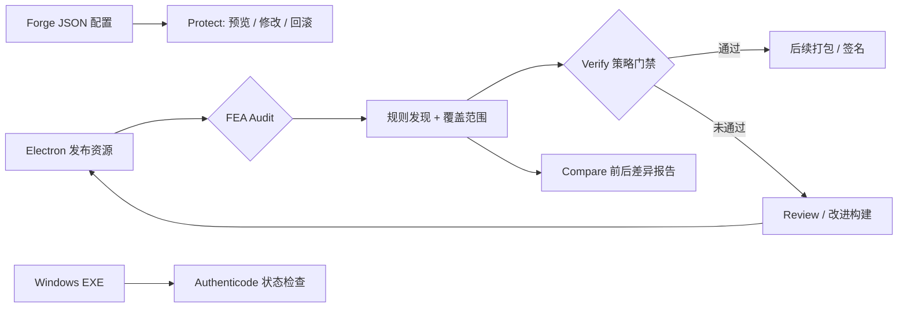

<div align="center">
  <!-- Original FEA identity, preserved byte-for-byte as assets/fea-icon.png. -->
  

  

  <br />

  [](https://github.com/MarsBaseX1/forward-engineer-anything/actions/workflows/fea-security.yml)
  [](LICENSE)
  
  

  **[English](README.en.md) · [5 分钟上手](#快速开始) · [真实演示数据](#可复现的关键数据) · [安全边界](#我们不承诺什么) · [参与贡献](CONTRIBUTING.md)**
</div>

> **v1.0.0 正式发布：** FEA 已完成从发布卫生检查到抗 REA 加固框架的演进。规则 FEA001–FEA009、Forge 自动化、建议生成器与 Arena 评测协议现已稳定。详见 [CHANGELOG.md](CHANGELOG.md)。边界声明保持不变：不承诺无法逆向。

> **FEA（Forward Engineer Anything）** 是面向桌面软件开发者的开源**保护工程框架**。它帮助团队在交付 Windows / macOS 应用前，发现不必要的敏感资源暴露、建立可重复的 CI 门禁、规划加固并验证效果。**目标是提高 REA 类 AI 辅助逆向与篡改的成本，不是承诺软件无法逆向。**

### 为什么需要 FEA？

AI 辅助逆向（如 [REA](https://github.com/morluto/rea)）正在降低分析已发布软件的门槛。与其发布后再尝试隐藏一切，不如在构建阶段先回答三个问题：**客户端带走了什么？哪些调整确实减少了暴露？下一次发布是否让风险重新出现？**

FEA 当前聚焦 Electron：**静态检查 → 出具脱敏证据 → 阻止不合格发布 → 比较改进效果**。无需云模型、API Key 或付费服务即可运行扫描和演示。详细防护策略见 [ANTI-REA-HARDENING.md](docs/ANTI-REA-HARDENING.md)。

## 可复现的关键数据

<div align="center">
  
</div>

| 指标 | 本仓库可复现结果 | 代表什么 |
| :--- | ---: | :--- |
| **11 → 0** | 演示样本的扫描发现数 | 人为植入的暴露项在改进样本中被移除 |
| **9 类** | FEA001–FEA009 | Source Map、私钥、内部配置、调试资源、测试资源、客户端授权、硬编码密钥、未混淆逻辑、客户端数据暴露 |
| **CI 自动验证** | 自动化测试通过 | 包括 ASAR 异常输入、安全边界与跨平台降级的测试 |
| **2 种** | 目录 / `.asar` | 当前受限支持的 Electron 资源输入形态 |

**数据来源与复现：** `npm test && npm run demo && npm run demo:check`。图表由 [`demo/check.mjs`](demo/check.mjs) 生成的 `comparison.json` 自动绘制，具体规则计数可在运行后的 `demo/generated/reports/comparison/comparison.json` 查看。脚本在 [`scripts/render-readme-chart.mjs`](scripts/render-readme-chart.mjs)。

> ⚠️ **演示数据不是商业软件安全测评。** 11 → 0 只反映同一合成样本中可观察的信息暴露项变化，不代表逆向破解概率下降 100%、真实产品没有漏洞，或对 AI 逆向具备可量化抵抗力。

## FEA 如何工作



### 已实现的能力

| 功能 | 现阶段能力 | 限制 |
| :--- | :--- | :--- |
| **Audit** | 扫描 Electron 资源目录和受限 ASAR，检测 FEA001–FEA009 | 不是通用 EXE/安装器解析器 |
| **Verify** | 对脱敏报告执行策略检查，在 CI 中阻断失败样本 | 报告来源必须由可信构建流水线保证 |
| **Compare** | 输出加固前后 JSON / Markdown 变化报告 | 不是 AI 攻击成功率测试 |
| **Protect** | 对支持的 Forge JSON 文件提供预览/应用 ASAR + 推荐完整性 Fuses、精确回滚 | 不执行未知配置、不代表软件已经加密 |
| **Migrate / Obfuscate / Runtime** | 生成服务端迁移、可选混淆与运行时保护建议 | 不自动改写代码 |
| **Signature (Preview)** | Windows 下通过系统工具检查 Authenticode 状态及可选签发者指纹 | 非 Windows 返回“未评估”；不负责签名证书申请 |

## 快速开始

环境：**Node.js 20+**；仓库扫描器与演示无需额外 npm 依赖。

```bash
# 获取源码
git clone https://github.com/MarsBaseX1/forward-engineer-anything.git
cd forward-engineer-anything

# 运行单元测试和可复现演示
npm test
npm run demo
npm run demo:check

# 查看生成的对比报告
cat demo/generated/reports/comparison/comparison.md
```

**扫描你自己的构建资源：**

```bash
node src/cli.mjs init --out my-fea.json
node src/cli.mjs scan ./my-electron-resources --config my-fea.json --out ./audit/resources
node src/cli.mjs verify ./audit/resources/report.json --policy my-fea.json

# 迁移与混淆建议
node src/cli.mjs migrate ./audit/resources/report.json --out ./audit/migrate
node src/cli.mjs obfuscate ./audit/resources/report.json --out ./audit/obfuscate
node src/cli.mjs runtime ./audit/resources/report.json --out ./audit/runtime

# 只读 ASAR 扫描
node src/cli.mjs asar-scan ./my-app.asar --config my-fea.json --out ./audit/asar
```

Windows 系统还可运行 `node src/cli.mjs signature ./my-app.exe --out ./audit/signature --thumbprint <预期签名证书指纹>`；其他平台会明确标记“未评估”。命令与限制见 [完整使用说明](IMPLEMENTATION.md)。

## 我们不承诺什么

- **已交付到客户端的代码仍可能被逆向、修改或重新实现。** ASAR 归档不是保密边界。
- 扫描通过不等于没有秘密、没有漏洞、授权无法被绕过。客户端判断不能替代服务端授权。
- 签名检查不等于加密代码；本工具也不会生成合法的 Windows/macOS 签名。
- 当前不支持任意 EXE / MSI / DMG 分析、自动加壳或真实 AI 逆向能力评分。
- **v1.0.0 为稳定发布**，仍不代表独立审计或安全认证；真实发布前请核验支持格式和异常边界。

## 下一步与贡献

详见 [路线图](docs/ROADMAP.md) 和 [威胁模型](docs/THREAT_MODEL.md)。欢迎贡献规则、合成测试样本与适配器。请先阅读 [CONTRIBUTING.md](CONTRIBUTING.md)。项目采用 [Apache-2.0](LICENSE) 协议。FEA 是独立项目，不受 REA 或 Trivy 团队背书。
