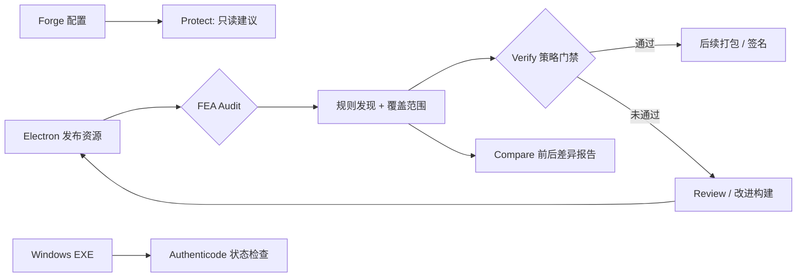

<div align="center">
  <!-- Original FEA identity, preserved byte-for-byte as assets/fea-icon.png. -->
  

  

  <br />

  [](https://github.com/MarsBaseX1/forward-engineer-anything/actions/workflows/fea-security.yml)
  [](LICENSE)
  
  

  **[English](README.en.md) · [5 分钟上手](#快速开始) · [真实演示数据](#可复现的关键数据) · [安全边界](#我们不承诺什么) · [参与贡献](CONTRIBUTING.md)**
</div>

> **FEA（Forward Engineer Anything）** 是面向桌面软件开发者的开源发布安全检查工具。它帮助团队在交付 Windows / macOS 应用前，发现不必要的敏感资源暴露、建立可重复的 CI 门禁，并对比加固前后的结果。**目标是提高分析与篡改成本，不是承诺软件无法逆向。**

### 为什么需要 FEA？

AI 辅助逆向正在降低分析已发布软件的门槛。与其发布后再尝试隐藏一切，不如在构建阶段先回答三个问题：**客户端带走了什么？哪些调整确实减少了暴露？下一次发布是否让风险重新出现？**

FEA 当前聚焦 Electron：**静态检查 → 出具脱敏证据 → 阻止不合格发布 → 比较改进效果**。无需云模型、API Key 或付费服务即可运行扫描和演示。

## 可复现的关键数据

<div align="center">
  
</div>

| 指标 | 本仓库可复现结果 | 代表什么 |
| :--- | ---: | :--- |
| **6 → 0** | 演示样本的扫描发现数 | 人为植入的暴露项在改进样本中被移除 |
| **5 类** | FEA001–FEA005 | Source Map、私钥格式标记、内部配置、调试资源、测试资源 |
| **33 / 33** | 本地自动化测试通过 | 包括 ASAR 异常输入、安全边界与跨平台降级的测试 |
| **2 种** | 目录 / `.asar` | 当前受限支持的 Electron 资源输入形态 |

**数据来源与复现：** `npm test && npm run demo && npm run demo:check`。图表由 [`demo/check.mjs`](demo/check.mjs) 生成的 `comparison.json` 自动绘制，具体规则计数可在运行后的 `demo/generated/reports/comparison/comparison.json` 查看。脚本在 [`scripts/render-readme-chart.mjs`](scripts/render-readme-chart.mjs)。

> ⚠️ **演示数据不是商业软件安全测评。** “6 → 0”只反映同一合成样本中可观察的信息暴露项变化，不代表逆向破解概率下降 100%、真实产品没有漏洞，或对 AI 逆向具备可量化抵抗力。

## FEA 如何工作



### 已实现的能力

| 功能 | 现阶段能力 | 限制 |
| :--- | :--- | :--- |
| **Audit** | 扫描 Electron 资源目录和受限 ASAR、检测五类发布风险 | 不是通用 EXE/安装器解析器 |
| **Verify** | 对脱敏报告执行策略检查，在 CI 中阻断失败样本 | 报告来源必须由可信构建流水线保证 |
| **Compare** | 输出加固前后 JSON / Markdown 变化报告 | 不是 AI 攻击成功率测试 |
| **Protect (Preview)** | 给 Electron Forge JSON 配置提供可审查建议 | 不自动改写配置，不执行目标项目代码 |
| **Signature (Preview)** | Windows 下通过系统工具检查 Authenticode 状态及可选签发者指纹 | 非 Windows 返回“未评估”；不负责签名证书申请 |

## Arena v0.3（实验性评测协议）

Arena 现在支持读取**已授权、预先采集的配对实验日志**，检查相同任务、引擎、预算及种子，并生成成功率、超时和成本的报告。内置演示仅采用脚本化合成数据，**不运行 AI 逆向，也不证明能够阻止逆向**。

```bash
npm run demo && npm run demo:check && npm run arena:demo
node src/cli.mjs arena compare demo/generated/reports/arena/baseline.json demo/generated/reports/arena/hardened.json --suite demo/arena-suite.json --out demo/generated/reports/arena/manual
```

[评测协议与限制](docs/ARENA.md)。原始品牌图标依旧使用 `assets/fea-icon.png`，保持原样。

## v0.3.1：只读 MCP、服务端授权与外部评测证据

新增 **stdio MCP 服务**：只公开三种只读工具，读取启动时由开发者指定的脱敏扫描报告，不允许 Agent 通过工具读取任意路径、执行目标程序或修改资源。独立的本地授权示例演示**账户、租户、资源、操作、有效期、撤销、额度**均由服务端决定，不信任客户端自称的会员状态。

```bash
npm test
npm run demo && npm run demo:check
npm run mcp:demo && npm run auth:demo
npm run arena:import-demo
node src/mcp.mjs --report demo/generated/reports/hardened/report.json --policy .fea.json
```

`arena import` 可接收已获授权、由外部 Agent 生成的 **JSONL 任务日志与 SHA-256 证据摘要**，剔除原始轨迹，再用于已有配对评测。**随仓库提供的导入演示仍是合成数据，没有运行真实 AI 逆向任务**；外部日志不自动等于可靠事实。详见 [MCP 文档](docs/MCP.md)、[服务端授权](docs/AUTHORIZATION.md)、[Agent 接口](docs/AGENT-ADAPTER.md)。

## v0.3.2：可执行的配对 Arena 实验（实验性）

新增 `arena execute`：只运行**由操作者明确指定并信任的本地 Node.js `.mjs` 适配器**，以相同任务、种子和预算逐次测试自有或授权的基线 / 加固构建；默认最多 400 次试验、每次最长 60 秒，且必须显式确认授权。结果包含任务状态、耗时、适配器自报成本和 SHA-256 证据摘要；比较报告不记录原始输出或凭据。

```bash
npm run demo && npm run arena:execute-demo
node src/cli.mjs arena execute --suite demo/arena-suite.json --baseline demo/generated/baseline/app.asar --hardened demo/generated/hardened/app.asar --adapter demo/trusted-observer.mjs --engine demo/arena-executor-engine.json --out demo/generated/reports/arena-execution --i-own-artifacts
```

**边界：** 内置适配器只观察自有合成资源，**没有调用 AI 模型**。执行器不是沙箱，不能信任陌生脚本；远程模型用量由适配器自报，FEA 无法独立核实费用和攻击成功条件。需要真实 Agent 评测时应提供独立审核的适配器、合法测试目标、隔离环境及受控预算。详见 [执行器文档](docs/ARENA-EXECUTOR.md)。

## 快速开始

环境：**Node.js 20+**；仓库扫描器与演示无需额外 npm 依赖。

```bash
# 获取源码
git clone https://github.com/MarsBaseX1/forward-engineer-anything.git
cd forward-engineer-anything

# 运行单元测试和可复现演示
npm test
npm run demo
npm run demo:check

# 查看生成的对比报告
cat demo/generated/reports/comparison/comparison.md
```

**扫描你自己的构建资源：**

```bash
node src/cli.mjs init --out my-fea.json
node src/cli.mjs scan ./my-electron-resources --config my-fea.json --out ./audit/resources
node src/cli.mjs verify ./audit/resources/report.json --policy my-fea.json

# v0.2：只读 ASAR 扫描（需要实际存在的 .asar 文件）
node src/cli.mjs asar-scan ./my-app.asar --config my-fea.json --out ./audit/asar

# v0.2：只读 Forge 构建建议
node src/cli.mjs plan ./my-electron-project --out ./audit/plan
```

Windows 系统还可运行 `node src/cli.mjs signature ./my-app.exe --out ./audit/signature --thumbprint <预期签名证书指纹>`；其他平台会明确标记“未评估”。命令与限制见 [完整使用说明](IMPLEMENTATION.md)。

## GitHub Actions：把检查带进 CI

[查看实际工作流](.github/workflows/fea-security.yml) · [查看 CI 运行状态](https://github.com/MarsBaseX1/forward-engineer-anything/actions/workflows/fea-security.yml)

示例工作流在 **Windows / Ubuntu** 上运行测试、生成有意暴露资源的基线与改进样本，并验证目录扫描和 ASAR 扫描的差异。随后上传脱敏的演示报告。**它不会自动审计你业务软件的正式安装包**；接入自己的工程时，需要将扫描输入绑定到可信构建产物。

## 项目定位：与其他开源工具有什么不同？

| 工具 | 主要目的 | 与 FEA 的关系 |
| :--- | :--- | :--- |
| **FEA**（本项目） | 交付前发现 Electron 资源暴露、验证发布策略、比较改动 | 关注**开发者的发布阶段** |
| [REA — Reverse Engineer Anything](https://github.com/morluto/rea) | 辅助分析已经发布的软件 | 帮助研究软件；与 FEA 独立、无隶属关系 |
| [Trivy](https://github.com/aquasecurity/trivy) | 广泛扫描镜像、文件系统、依赖漏洞、配置与秘密 | 覆盖面更广；FEA 专注桌面发布资源与可复验门禁 |

以上是**用途区分，不是性能排名**；没有开展跨项目的相同样本、相同预算安全基准测试。

## 我们不承诺什么

- **已交付到客户端的代码仍可能被逆向、修改或重新实现。** ASAR 归档不是保密边界。
- 扫描通过不等于没有秘密、没有漏洞、授权无法被绕过。客户端判断不能替代服务端授权。
- 签名检查不等于加密代码；本工具也不会生成合法的 Windows/macOS 签名。
- 当前不支持任意 EXE / MSI / DMG 分析、自动加壳或真实 AI 逆向能力评分；macOS 签名验证仍在路线图中。Arena v0.3 仅验证外部运行日志和提供脚本化样本。
- **v0.2 属于实验实现**，不代表独立审计或安全认证；真实发布前请核验支持格式和异常边界。

## 下一步与贡献

`v0.1` 提供资源扫描和 CI 门禁；`v0.2` 增加有边界的 ASAR 检查、Forge 审查建议和 Windows 签名状态；下一步将推进规则覆盖、稳定的 SARIF 输出、更多经验证的构建适配器与有授权的对抗评测。详见 [路线图](docs/ROADMAP.md) 和 [威胁模型](docs/THREAT_MODEL.md)。

欢迎贡献规则、合成测试样本与适配器。请先阅读 [CONTRIBUTING.md](CONTRIBUTING.md)。项目采用 [Apache-2.0](LICENSE) 协议，不要求使用者开源自己的商业软件。FEA 是独立项目，不受 REA 或 Trivy 团队背书。
