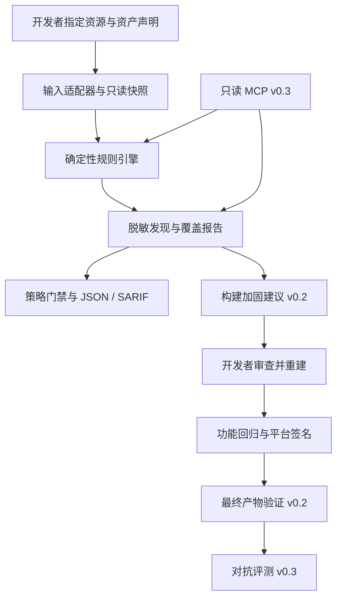

# Forward Engineer Anything：产品与架构设计

日期：2026-10-21。状态：供评审的设计稿，尚未实现。

## 1. 用户目标与设计假设

用户希望设计名为 Forward Engineer Anything 的 GitHub 项目，用于应对 REA 等 AI 辅助逆向工具，保护软件免于逆向与破解。用户已明确选择 Windows / macOS 桌面应用作为首版方向。

设计将“保护一切”的愿景转为可验证的工程目标：减少非必要交付的敏感资产，建立正确授权边界，提高特定分析任务成本，并持续检查发布回归。不能承诺任何软件永远无法分析、修改或功能复刻。

以下是设计建议，而非用户额外指定：先从两平台共有的 Electron 资源层切入；采用 CLI 和确定性策略引擎；后续逐步加入构建补丁、平台验证、MCP 与公开对抗基准。其好处是首版具有清晰输入与可测试结果，避免同时建设多个复杂运行时。

## 2. REA 的相关事实

REA 官方仓库为 [morluto/rea](https://github.com/morluto/rea)。本次只读研究固定到[提交 a5f982d 的官方 README](https://github.com/morluto/rea/blob/a5f982de8dbe4b092cc20ab89d492b7e7028b758/README.md)，未运行 REA。官方说明覆盖从应用行为到二进制分析，并通过 MCP / CLI 对接分析工具。因此，针对 REA 的防护需要覆盖资产暴露、架构与发布流程，不能依赖单一文件封装。

“Anything” 与社交传播热度不作为技术能力证据。FEA 不依赖某个 REA 版本的失败，也不把合法逆向研究一概定义为攻击。

## 3. 路线比较

| 路线 | 优点 | 成本与限制 | 结论 |
|---|---|---|---|
| 跨平台通用加壳 / 二进制重写 | 保护动作直观，可针对部分分析任务增加成本 | 语言、ABI、平台、签名与兼容性成本高；无法保证保密 | 不作为项目核心 |
| 资产检查 + 构建加固 + 信任边界 | 能进入日常发布流程，有可验证的工程收益 | 自动化必须限定支持的构建链；架构改动需要产品权衡 | 推荐主线 |
| 自动对抗评测 | 证据可比较，适合公开演示与持续改进 | 受任务、预算、模型与样本影响，不能代替防护本身 | 作为验证层分阶段加入 |

主张：以第二条路线提供保护工程能力，以第三条路线验证部分收益；必要时接入成熟、合法的加固工具，但每个插件单独说明收益与代价。

## 4. 产品组成

### Audit：发现暴露

输入开发者明确指定的资源目录与资产声明，建立只读快照并运行规则。每条发现包含规则编号、相对路径、位置、严重性、置信度、脱敏证据、建议与适用边界。

首版五类规则为：

| 编号 | 检查类别 | 判定方式与限制 |
|---|---|---|
| FEA-EXP-001 | source map | 检查映射文件格式与内联映射；URL 引用单独记录，不主动抓取远端 |
| FEA-EXP-002 | 私钥与凭据候选 | 使用格式与上下文规则；不以高熵字符串直接认定有效密钥，不联网试用 |
| FEA-EXP-003 | 内部配置 | 检查明确列出的配置文件和已声明敏感键；文件存在不自动证明泄漏真实凭据 |
| FEA-EXP-004 | 调试符号 | 识别已知符号文件；支持将诊断用途作为有期限例外，不自动删除 |
| FEA-EXP-005 | 开发与备份资产 | 检查项目声明不得发布的开发文件、测试数据和备份；不将全部 JS 源文件视为漏洞 |

严重性与置信度分开记录。用户可按发布政策禁止某种资产，不必将其包装为对所有软件都成立的漏洞。

### Protect：转为可审查的改动

从 v0.2 开始，为已支持构建链提出配置补丁，优先减少 source map、内部配置与调试资产的公开分发。保留私有诊断材料，说明修改对故障排查的影响。

对 Electron 提供 ASAR 完整性与相关 fuse 配置建议，并验证工具版本和配套条件。[Electron 官方完整性文档](https://www.electronjs.org/docs/latest/tutorial/asar-integrity)说明其运行验证及配套加载限制；具体版本条件必须进入适配器支持矩阵，不在通用规则中永久写死。

混淆、编译或符号精简属于后续可选适配器。修改已签名产物不属于安全的常规流程；补丁作用于源码或构建配置，随后重新构建、回归与签名。

涉及把商业算法或授权操作迁往服务端的建议，只生成设计与影响分析，不自动进行大范围产品改造。公网接口名称、许可证公钥和正常发布的 API 标识也不应被统一当作秘密。

### Verify：检查策略与发布证据

v0.1 只对报告执行策略判定。v0.2 增加平台工具与最终包证据，分别验证平台签名、预期发布者、完整文件清单与资源完整性。

签名检查不代表代码保密。Windows PE 签名也不等于完整文件逐字节哈希匹配。[Microsoft 签名覆盖说明](https://learn.microsoft.com/en-us/windows/win32/secbp/understanding-pe-signatures)

发布顺序为：构建配置改动 → 重建 → 功能回归 → 平台封装与签名 → 对最终发布产物生成清单及检查 → 既有发布流程。FEA 不在扫描时自动发布软件。

### Arena：检验保护收益

v0.3 引入自有样本与可选 REA 适配器。任务包括识别演示敏感资产、解释选定业务流程、判断是否可以取得服务端受保护结果，以及在固定测试集中重建一项可观察行为。

任务成功由独立测试或人工复核证据判定，不能由分析模型自报成功或失败。FEA 不给出通用“防逆向 98 分”；比较针对明确任务、样本与预算。

## 5. 架构与数据流



FEA 核心由配置解析器、快照器、规则引擎、策略引擎和报告器组成。CLI 与未来 MCP 共用核心；适配器负责格式差异，不能改变核心判定语义。

建议首版采用 TypeScript 与实施时仍受维护的 Node.js LTS。具体运行时、依赖与锁文件在实现前核实。原生验证通过固定参数的可信平台工具适配器完成，不为首版引入通用二进制重写引擎或自制密码算法。

以下为未来代码目录草案，当前未创建：

```text
packages/core/                 配置、快照、规则与策略
packages/cli/                  CLI 与退出码
packages/adapters/electron/    资源目录；后续 ASAR 与构建适配
packages/adapters/windows/     后续平台验证
packages/adapters/macos/       后续平台验证
packages/mcp/                  后续只读代理接口
rules/                        版本化的内置规则
fixtures/                     合成输入与预期结果
examples/electron-demo/        后续基准应用
benchmarks/                    后续任务、环境与证据
```

## 6. 输入输出契约

输入由一个根目录、来源阶段、规则配置与可选资产声明组成。v0.1 根目录只支持普通资源树；原始 ASAR、安装器和二进制内容不被当作已完成检查。若属于策略要求的范围，则运行不完整并阻止通过。

ASAR 作为根输入始终拒绝。目录内声明必须展开检查的容器遇到不支持格式时退出 2；策略明确允许作为不透明资源分发的业务容器可保留，但其内部标为 `not_assessed`，不计入内容检查覆盖。资源规则的适用范围与这种接受风险的声明均进入报告。

支持范围按“输入 × 检查能力”公布，而非仅写操作系统名称：

| 阶段 | 输入 | 已规划的检查 | 保留边界 |
|---|---|---|---|
| v0.1 | 普通 Electron 发布资源目录 | 五类暴露规则与策略 | 不推断完整安装包的状态 |
| v0.2 | Electron ASAR 与外置资源 | 归档内容检查与资源完整性配置 | 加入解析器验证后才支持 |
| v0.2 | Windows 解包应用目录中的 PE 文件 | 平台签名、预期发布者与清单 | 不等于原生代码分析；不解析 MSI 安装内容 |
| v0.2 | macOS `.app` 应用包 | 本机平台签名、适用的公证与清单 | 不挂载或解析 DMG；不等于原生代码分析 |
| v0.4 | .NET、PE / Mach-O 等原生输入 | 按独立适配器增加内容检查 | 每种格式分别验收 |

配置设计示例，尚无解析器实现：

```yaml
schemaVersion: 1
profile: electron-resources
input:
  root: ./release-resources
  stage: prepackage
output:
  directory: ./.fea/reports/release
rules:
  enabled:
    - FEA-EXP-001
    - FEA-EXP-002
    - FEA-EXP-003
    - FEA-EXP-004
    - FEA-EXP-005
policy:
  failOnSeverity: high
  denyRules:
    - FEA-EXP-001
  requireCompleteCoverage: true
privacy:
  redactEvidence: true
exceptions: []
```

路径相对于配置文件解析，并进行边界检查。`stage` 为 `prepackage` 或 `developer-extracted`；后者还需记录开发者提供的来源标识。配置不允许嵌入 shell 命令或动态模块路径。CLI 输出路径可覆盖配置中的输出目录，但仍须通过相同边界验证。

单条发现的 JSON 设计示例：

```json
{
  "ruleId": "FEA-EXP-002",
  "severity": "high",
  "confidence": "high",
  "path": "config/demo-signing-key.pem",
  "line": 1,
  "evidence": "private-key structure detected; content redacted",
  "recommendation": "Remove signing material from client delivery and rotate real exposed keys.",
  "fingerprint": "demo-finding-001",
  "status": "open"
}
```

示例只有合成占位指纹，不含真实密钥。实现中的稳定指纹使用规则、规范化路径与非敏感结构信息；不公开秘密的普通哈希，以免对低熵值提供猜测依据。同一位置内容改变时重新评估，不能靠旧例外永久放行。

证据分为两层：受限本地附件包含原始相对路径、文件大小、内容摘要和执行清单；默认 JSON / SARIF 分享报告只包含脱敏后的发现、覆盖标识、必要运行元数据与策略结果，不自动内嵌原始清单或其内容摘要。文件摘要也可能成为低熵秘密的猜测依据，因此原始附件不可作为普通 CI 分享报告上传。

报告包含 `schemaVersion`、工具 / 规则版本、执行覆盖标识、输入阶段、运行时间、发现列表、例外状态与策略结果。配置路径、配置键、文件名、相对路径与 URL 参数也经过同一脱敏模型；SARIF 的 URI 使用脱敏别名，原始位置映射保留在本地附件。规范化发现列表独立于时间戳。

`scanStatus` 为 `completed`、`partial` 或 `error`。逐项检查结果为 `pass`、`fail`、`not_assessed` 或 `not_applicable`；不适用必须有可检查的理由。未知不能当作通过。

v0.1 退出码契约：

| 退出码 | 含义 |
|---|---|
| 0 | 所需范围检查完整且策略通过 |
| 1 | 检查完整但策略不通过 |
| 2 | 配置、输入、权限、超限或依赖错误，或必需范围未完成 |

发生扫描错误与策略失败时优先返回 2。尽可能保留部分报告，并明确不能作为放行证据。

生产门禁不允许关闭必需范围的完整性要求。探索性运行可以保留部分结果，但仍返回 2；`requireCompleteCoverage` 在 v0.1 只接受 `true`，避免通过配置把未知结果改成成功。

`scan` 检查当前输入并执行当前策略。`verify` 需要可信 CI 来源的报告及对应执行覆盖证据，逐项检查当前必需规则是否实际运行、规则版本是否一致、支持范围是否满足要求；缺项、规则关闭或版本不匹配时退出 2 并要求重扫。例外以本次验证时刻重新检查期限，不能沿用过期扫描结果中的豁免。仅对原发现列表重新筛选不足以证明新策略通过。

自包含摘要不能证明报告真实性。首版依赖可信 CI 与受控报告存储，不宣称提供报告签名认证。`verify` 不重新读取输入，也不能证明目录仍未变化；CI 必须对不可变构建快照运行 `scan`，不能拿旧报告验证新构建。

## 7. 错误处理与扫描器隔离

扫描器不执行目标项目的配置文件、JS、二进制或安装脚本。仅静态读取支持的文件格式。文件内容与未来 MCP 返回数据均作为不可信数据处理，不把其中的指令提升为操作权限。

输入路径先规范化并检查真实范围；Windows 的 junction / reparse point 与 macOS 的符号链接进入统一边界模型。目录循环、大小写或 Unicode 规范化冲突、超限、权限不足、读取时变化都必须有明确诊断。

仅打开普通文件，拒绝管道、设备、socket 等特殊对象。v0.1 的安全前提是扫描可信构建环境提供、没有并发修改者的快照；发现变化时退出 2，但不声称基础路径检查可以抵御所有检查后替换。以后若接受对抗性可变目录，需先实现并验证打开后的对象身份与根目录边界控制。

输出根与输入根不能相交。终端转义、SARIF 内容、HTML 展示和日志分别处理注入与秘密泄露。首版只有 JSON / SARIF；HTML 需在加入时通过独立展示安全验证。

例外需要负责人、原因、到期日与受限匹配条件。到期或无法确认仍适用时不能继续静默豁免。具体扫描器要求见[威胁模型](../../THREAT_MODEL.md)。

## 8. 功能与效果验证

**确定性验证：** 使用合成正例、负例与畸形输入检查规则。公布检测结果、误报与漏报，不把对公开夹具的完美结果当成真实软件的完美结果。对路径、资源上限、报告脱敏、策略退出码和跨平台行为做必要测试。

**功能回归：** 由被保护项目提供真实启动、更新、关键业务与诊断用例。FEA 记录哪些用例实际运行；没有运行不能显示“兼容性通过”。

**授权验证：** 后续参考 API 验证跨租户、未授权、过期、撤销和额度等负面用例。重复请求依业务语义选择幂等或重放防护，不一律视为攻击。服务端授权检查应覆盖每次敏感请求。[OWASP 授权指南](https://cheatsheetseries.owasp.org/cheatsheets/Authorization_Cheat_Sheet.html)

**对抗实验：** 固定同一业务源码提交、基线 / 改进配置、目标资产、模型与分析工具版本、时间和费用预算。每项默认至少 10 次独立运行，保留预先指定的种子与完整结果。样本少时明确不确定性，不推断对所有模型或软件成立。

至少同时公布：任务成功率、预算内首次成功时间、分析费用、超时与环境错误、包体、启动 / 请求延迟和合法用户失败情况。未成功任务按预算截尾报告；没有成功样本时不能声称平均破解时间无限大。保护效果与功能代价并列展示。

## 9. 隐私与开源治理

首版无需模型账号、遥测或外部服务。候选秘密不上传，不进行有效性探测。报告可能包含内部路径与资产关系，默认保存在受控构建环境；上传到 GitHub 的 SARIF 或 CI 附件同样需要按项目可见性处理。

未来启用外部 AI 或 MCP 宿主模型时，应明确发送哪些数据；“扫描在本地”不能替代对宿主模型数据流的说明。LLM 建议不作为策略引擎的权威结果。

用户已明确同意采用 Apache-2.0，仓库加入完整许可证；后续第三方依赖分别保留声明。公开算法、检查协议与测试工具，秘密留在正确边界；不要求业务代码开源，不在演示中包含第三方软件的未授权资料。

## 10. 交付边界与后续拆分

本轮交付是 GitHub 项目设计资料。用户已追加授权将设计资料发布到自己的 GitHub；发布仓库需明确标为设计阶段，不发布软件包，不生成虚构安装说明，不把路线图说成已有功能。

首个实现子项目仅为 v0.1 Audit / CI 门禁。Protect / 平台验证、Arena / MCP / 授权演示、原生扩展 / 更新安全分别作为后续独立子项目设计与验证。各版本范围与验收条件见[路线图](../../ROADMAP.md)。
